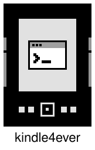
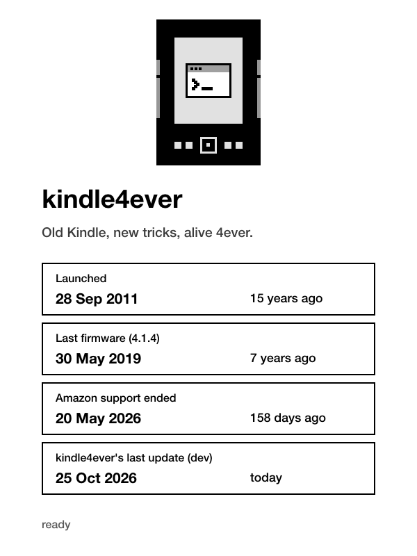
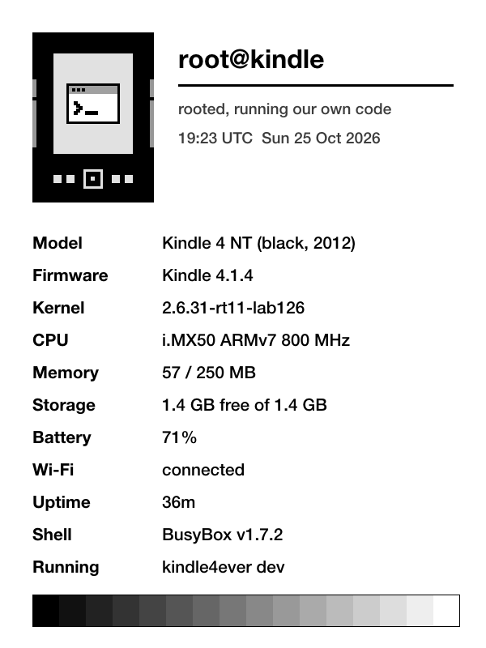
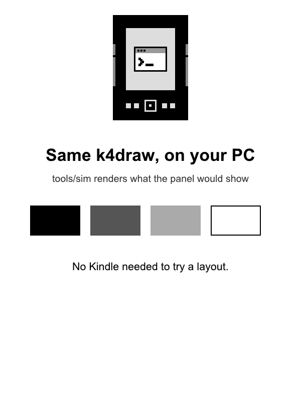

<p align="center">
  
</p>

<h1 align="center">kindle4ever</h1>

<p align="center"><strong>Old Kindle, new tricks, alive 4ever.</strong></p>

<p align="center">
  
  <a href="https://github.com/ibrarwtf/kindle4ever/releases/latest"></a>
</p>

Amazon stopped supporting the Kindle 4 Non-Touch in May 2026. This repo turns one into a small Linux e-ink computer
that you, or an AI coding agent, can program over Wi-Fi: jailbreak, root SSH, then your own drawing, buttons and HTTPS,
all as static binaries cross-compiled on your computer.

**Ready to build with your AI agents:** the tools give an agent everything it needs to work on the device by itself,
with screenshots, key presses, deploys, a self-test and recovery. kindle4ever itself was built that way, by an AI agent
on a real Kindle with a human doing only the physical steps ([docs/journey.md](docs/journey.md)).

> **Use at your own risk.** This is a decade-old device. Everything here works on mine, and this repo is what I did and documented.
> Never factory reset or deregister a Kindle 4: since support ended, it can't be registered again.

<p align="center">
  
  
  
</p>
<p align="center"><sub>Left and middle: screenshots from a real Kindle 4 NT. Right: <code>tools/sim</code> on a PC.</sub></p>

## Quick start
Tested on a Kindle 4 Non-Touch (2012, black) with firmware **4.1.4**. The jailbreak supports 4.0.0 to 4.1.4.

```sh
tools/setup-toolchain.sh && tools/fetch-vendor.sh && tools/build.sh   # on your computer
tools/stage-usb.sh /d jailbreak        # then restart the Kindle into the jailbreak
tools/stage-usb.sh /d usbnet-install   # then Update Your Kindle
tools/stage-usb.sh /d usbnet-config    # then restart and join Wi-Fi
tools/install.sh --amazon-block --amazon-off --no-browser --tz Asia/Kolkata --start
tools/k4 sh k4welcome                # your Kindle, running your code
```
The full walkthrough, with what to press on the Kindle at each step and a risk level for each: [docs/setup.md](docs/setup.md).

## What's inside
**On the Kindle** (`/mnt/us/kindle4ever/bin`, reference in [docs/tools.md](docs/tools.md)):

| Tool | Does |
|---|---|
| `k4draw` | Draws text (TrueType), shapes and images, with partial or full refresh. Exports the screen as PNG. |
| `k4keys` | Reads the 13 buttons: streams events, waits for one press, or grabs them from Amazon's UI. |
| `k4fetch` | Fetches HTTP and HTTPS with its own TLS 1.2. The stock OpenSSL 0.9.8j can't reach most sites. |
| `k4app` | Stops Amazon's UI so the screen and keys are yours, then gives them back. |
| `k4press`, `k4wait` | Injects key presses, and waits until the screen settles. |
| `k4welcome`, `k4about` | The welcome screen and the neofetch-style card above. |

**Apps** (`apps/`, installed with `tools/k4 app apps/<name>`, shown on the `k4home` home screen):

| App | Does |
|---|---|
| `livestation` | Indian Railways live platform board for your station, drawn as trains, fetched and rendered on the Kindle. [README](apps/livestation/README.md) |

**On your computer** (`tools/`):

| Tool | Does |
|---|---|
| `k4` | Drives the Kindle over SSH: `sh`, `shot` (timestamped screenshot), `press`, `push`, `run`, `deploy`, `doctor`, `sim`, `version` |
| `doctor.sh` | Self-test of SSH, display, keys, network, boot hook, power and space. `--markdown` gives a shareable report. |
| `sim` | The same `k4draw`, drawing into a file: see what the panel would show without a device |
| `install.sh` / `uninstall.sh` | Put kindle4ever on the Kindle (tools, a boot hook with a kill switch, Amazon block and phone-home off, browser off, time zone), or take it off. [docs/amazon.md](docs/amazon.md) explains the Amazon side |
| `find-kindle.ps1` / `.sh` | Find the Kindle on your network. It also ejects the USB drive, which is what turns the Kindle's Wi-Fi off. |

Settings (IP, MAC, key path) come from environment variables or a `k4.env` file ([example](k4.env.example)), so nothing personal lives in the repo.

## Build your own, or with your AI agents
A script app is just shell: `k4app on`, draw with `k4draw`, wait for `k4keys`, fetch with `k4fetch`, `k4app off`.
`device/bin/k4about` is a complete example. C apps live in `src/` and build static with `tools/kcc`.
Try layouts on your computer first with `tools/sim`. Point your coding agent at [AGENTS.md](AGENTS.md): it's the short version of how to drive and build on the device.

## Docs
- [setup.md](docs/setup.md): from a stock Kindle to SSH and kindle4ever
- [tools.md](docs/tools.md): every tool's options, output and exit codes
- [hardware.md](docs/hardware.md): verified device facts (display, buttons, partitions, power)
- [findings.md](docs/findings.md): online claims checked on a real device
- [recovery.md](docs/recovery.md): what to do when something breaks, from mild to drastic
- [journey.md](docs/journey.md): how it was built
- [research/](docs/research/): the research it started from

## Status
v1 works on one Kindle 4 NT. Reports from other units are welcome: paste `tools/doctor.sh --markdown` into an issue.
Next up: a UI toolkit, a home screen, and sleep with wake timers. See [CONTRIBUTING.md](CONTRIBUTING.md) and [CHANGELOG.md](CHANGELOG.md).

## Credits
- The jailbreak and USBNetwork are NiLuJe's packages, based on Yifan Lu's work, shared on [MobileRead](https://www.mobileread.com/forums/forumdisplay.php?f=150). `tools/fetch-vendor.sh` downloads them; they're not redistributed here.
- Bundled code, each with its license and pinned version in `third_party/`: [stb](https://github.com/nothings/stb) (public domain / MIT) and [BearSSL](https://bearssl.org/) (MIT).
- k4fetch's root CAs come from the Mozilla bundle, via curl.se.
- The research leaned on the MobileRead wiki and forums, KOReader, FBInk, kindle-dash and others ([docs/research](docs/research/)).

MIT licensed. Not affiliated with Amazon.
