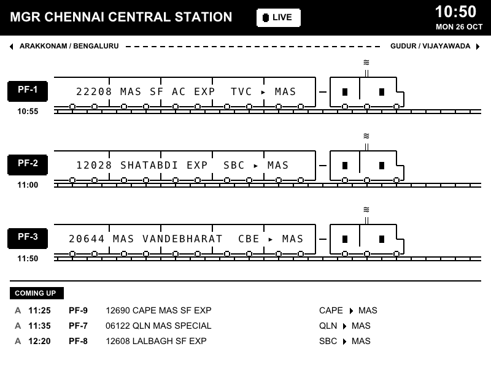

# Live station: an Indian Railways platform board on the Kindle

Shows what is on each platform of one station right now, drawn as trains, plus the next arrivals. Everything runs on the
Kindle: `k4fetch` queries NTES (the official Indian Railways enquiry site), three small awk programs parse and lay it out,
`k4draw` paints it in landscape. One refresh costs about 1.2 s of CPU and under 1.5 MB of RAM.



## Install
```sh
tools/fetch-vendor.sh                 # also downloads the DejaVu Sans Mono font the train drawings need
tools/k4 app apps/livestation         # copies the app and the font to /mnt/us/kindle4ever/apps/livestation
cp apps/livestation/station.conf.example my-station.conf   # edit: your station, its neighbours
tools/k4 push my-station.conf /mnt/us/kindle4ever/apps/livestation/station.conf
```
Keep `my-station.conf` out of the repo if you don't want your home station public. The app appears on the home screen
(`k4home`) as "Live station".

## How the board reads
- One train per platform. Full train centred = on the platform. Engine and front coaches entering from one side = arriving
  (arrival time under the platform number). Rear coaches only, cut off at the edge = just departed (departure time shown).
- Trains move toward the side of their destination: `LEFT`/`RIGHT` name what lies on each side, `RIGHT_SIDE` lists the
  station codes on the right. A train ending here is drawn arriving from the opposite side.
- "Coming up": the next three trains not already drawn, `A` = arrival, `D` = departure for trains starting here.
- Times are NTES expected times (delay included). NTES drops trains once they leave, so "departed" is only shown while
  NTES still lists the train.

## Keys
Select refreshes now. Back or Home returns to the home screen. Otherwise it refreshes every `REFRESH` seconds.

## Versions
Apps carry their own version in the `# version:` line of `app.sh` (printed by `tools/k4 app`), independent of the kindle4ever
release they ship in. 0.1.0 (kindle4ever v1.2.0): first version, NTES live station, landscape train board, config file.

## Files
`app.sh` fetch loop and keys · `ntes.awk` HTML to `no|name|src|dst|arr|dep|pf` rows · `board.awk` rows to the 64x24 text
board · `render.awk` text board to k4draw commands · `icon.sh` the home-screen train · `station.conf.example` config.
Design notes and the text-grid prototype came from the author's private station-board project; the drawing style
(square coaches, diesel engine with exhaust, track under the wheels) is reproduced here from the board text.
